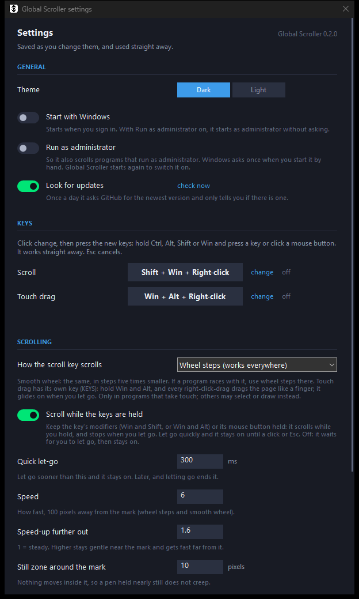

# Global Scroller

**A browser-style autoscroller that works in every program - for a broken
middle mouse button, or when Windows Ink is turned off. An alternative to
middle-click scrolling and to Windows Ink's drag-to-scroll.**

I made it for drawing tablets with **Windows Ink turned off**. A lot of us turn
Ink off because it gets in the way of drawing apps, and then the pen stops
scrolling pages the way a finger does. It works the same with a mouse.

AutoHotkey v2 · Windows 10 and 11 · no account, no tracking

## How to use it

Two keys, two ways to move a page:

**Scroll: Win + Ctrl + click.** A small round mark shows up where you
clicked. With a pen, that's just a touch of the tip.

- Move away from the mark. The window scrolls that way, and the further you go,
  the faster. Come back to the mark and it stops. Sideways works too.
- **Hold or tap.** Keep Win + Ctrl held and it scrolls while you hold; let go
  and it stops. Or let go right away (under 0.3 s) and it stays on until
  **Esc or any click**. That click does nothing else.
- With a mouse you can hold the button instead of the keys.

**Touch drag: Win + Shift + click** (experimental). While you hold Win +
Shift, every click-drag drags the page like a finger on a phone, and it
glides on when you let go of the button. Let go of the keys and everything is
normal again. It only works in programs that understand touch (browsers, most
modern apps); others may take it as a mouse drag and select text or draw, so
try it somewhere safe first.

## Download

From the [latest release](https://github.com/HamedGhadirian/Global-Scroller/releases):

| File | For |
|---|---|
| `Global-Scroller-x.y.z-portable.zip` | **Most people.** Unzip anywhere, run `Start Global Scroller.bat`. Nothing to install. |
| `Global-Scroller-x.y.z.zip` | If you already have [AutoHotkey v2](https://www.autohotkey.com/download/): unzip, run `Global-Scroller.ahk`. |

Its icon shows up in the tray. Right-click it for **Settings**, **Start with
Windows**, **Run as administrator**, **Look for updates now** and **Help**.

## Settings

Tray icon > **Settings**. Everything is saved the moment you change it and
works at once.

- **Keys**: click **change** next to Scroll or Touch drag and press the keys
  you want instead.
- **How the scroll key scrolls**: **wheel steps** (the default, works
  everywhere) or **smooth wheel** (steps five times smaller, so the page moves
  a few pixels at a time; if a program races with it, use wheel steps there).
- Speed, how fast it speeds up, the still zone around the mark, sideways
  scrolling, and programs where the keys should be left alone.
- **Theme**: dark or light.

It's all in `Global-Scroller.ini` beside the script too, if you'd rather edit a file.

## Good to know

- **Windows that run as administrator** ignore it, unless you turn on **Run as
  administrator** (one Windows prompt at start; with Start with Windows on,
  not even that).
- **Updates**: once a day it asks GitHub whether there's a newer version and
  tells you. **Update now** does the rest and keeps your settings; nothing
  installs without your click. Settings can turn the question off. That
  question is the only thing it sends anywhere.
- **The held keys stay hidden**: while you hold them to scroll, other programs
  don't see them, so Ctrl + wheel (zoom) or Shift + wheel shortcuts don't fire
  by accident.
- A few Store apps, like Settings, stop scrolling once the pointer leaves their
  window.
- If an old program scrolls way too fast, set **Smallest step** to 120.

If something acts weird, open an issue.

## The code

`Global-Scroller.ahk` only starts things; the scrolling is `lib\Scroll.ahk`.
The settings window, tray menu, keys, Start with Windows and updates come from
`lib\Kit`, shared by a small family of apps. Tests: `tests\run-tests.ps1`.
Both zips are built on GitHub from the tag, after the tests pass.

MIT - see [LICENSE](LICENSE).
